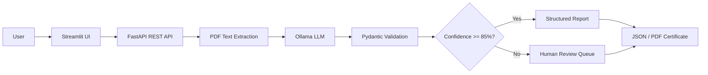

# 🔎 SpecCheck — PDF Specification Compliance Checker

[](https://github.com/your-username/speccheck/actions)
[](https://www.python.org/)
[](https://www.docker.com/)
[](LICENSE)

> AI-powered document auditing with **strict Pydantic validation**, **confidence scoring**, **human-in-the-loop** routing, and **dynamic inspection profiles**.

---

## The Problem

Manual specification-compliance checking is **slow, expensive, and error-prone**.

| Issue | Impact |
|---|---|
| Human fatigue | Missed deviations on page 180 |
| Inconsistent severity grading | Two engineers rate the same defect Level 2 vs Level 5 |
| No audit trail | Cannot prove which clauses were checked |
| Slow turnaround | Days to produce a compliance report |

The result: **costly rework, customer rejections, and regulatory fines**.

---

## The Solution

SpecCheck automates clause-by-clause compliance verification using a local LLM (Ollama) and **enforces structured output via Pydantic** — so every result is machine-readable, traceable, and reviewable.



---

## Key Features

### 1. Strict Structured Outputs (Pydantic / JSON Mode)

Every LLM response is parsed and validated against an exact schema:

```python
class ComplianceCheck(BaseModel):
    check_id: str          # CHK-001
    clause_reference: str  # §4.2.1
    requirement: str       # "Voltage must not exceed 240V"
    status: Literal["PASS", "FAIL"]
    deviation_found: str   # "Measured 260V on line 3"
    severity_level: int    # 1-5
    recommended_fix: str   # "Install voltage regulator VR-200"
    confidence_score: float # 0.0-1.0
    needs_human_review: bool
    review_reason: str
```

Ollama is instructed via `format: "json"` and `temperature: 0.1` to emit only valid JSON. Pydantic catches schema violations before any downstream code runs.

### 2. Dynamic Schema & Rule Selection

Instead of hardcoding one schema, SpecCheck supports multiple **inspection profiles**:

| Profile | Use Case | Schema |
|---|---|---|
| `pcb-manufacturing` | IPC-A-610, Gerber specs | `PcbInspectionReport` |
| `iso-compliance` | ISO 9001 §8.6 | `IsoInspectionReport` |
| `commercial-invoice` | Invoice completeness | `InvoiceInspectionReport` |

Users select a profile via the UI or API. FastAPI dynamically loads the corresponding Pydantic schema and system prompt.

### 3. Confidence Score & Human-in-the-Loop

The model self-reports a `confidence_score` per check. The backend automatically:

```python
if check.confidence_score < 0.85 or spec_is_ambiguous:
    check.needs_human_review = True
    enqueue_review(check, document_name, reason)
```

Review tickets are stored in `data/reviews/` and surfaced in the UI's **Review Queue** tab.

### 4. Fallback Strategy & Retry Logic

Production systems handle model failures gracefully. Ollama calls include:

- **Max 3 retries** with exponential backoff
- **JSON repair** on parse failure (strip code fences, remove trailing commas)
- **Temperature decay** on retry (0.1 -> 0.05 -> 0.0) to escape bad generation loops

### 5. Inspection Metrics & Performance Benchmarks

Every response includes runtime telemetry:

```json
{
  "processing_time_ms": 3421.5,
  "tokens_per_second": 18.3,
  "model_version": "llama3.1:8b-instruct-q4_K_M",
  "prompt_tokens": 1240,
  "completion_tokens": 450
}
```

Rendered in the UI's **System Performance** panel.

### 6. Audit Logging & Exportable Reports

- **Trace Logging**: Every inspection is logged as a structured JSON line to `logs/audit.log` with timestamp, event type, document, profile, counts, and metrics.
- **PDF Certificate**: A formatted `Certificate of Inspection` PDF is auto-generated using ReportLab, complete with timestamp, pass/fail badge, and deviation details.

---

## Architecture

```
User -> Streamlit UI -> FastAPI REST API -> Local Ollama Engine -> Pydantic Validation
```

---

## Quick Start

### One-Command Setup (Docker)

```bash
git clone https://github.com/your-username/speccheck.git
cd speccheck
docker compose up --build
```

Then open:
- Frontend UI: http://localhost:8501
- API Docs: http://localhost:8000/docs
- Ollama: http://localhost:11434

---

## API Reference

### POST /api/v1/inspect

Upload PDF + specification + optional profile_id.

### GET /api/v1/profiles

List available inspection profiles.

### GET /api/v1/reports/{report_id}

Download JSON report.

### GET /api/v1/reports/{report_id}/pdf

Download PDF certificate.

### GET /api/v1/reviews

List open human-review tickets.

---

## Project Structure

```
speccheck/
├── backend/
│   ├── main.py            # FastAPI server
│   ├── schemas.py         # Pydantic models
│   ├── ollama_client.py   # Ollama logic & retry wrappers
│   ├── pdf_reader.py      # Text extraction
│   ├── review_queue.py    # HITL ticket store
│   ├── rule_profiles.py   # Dynamic schema/rule selection
│   ├── audit_logger.py    # Structured JSON audit logging
│   ├── report_exporter.py # PDF certificate generation
│   └── requirements.txt
├── frontend/
│   ├── app.py             # Streamlit UI consuming REST API
│   └── requirements.txt
├── tests/
│   ├── test_schemas.py
│   └── test_inspector.py
├── .github/workflows/ci.yml
├── docker-compose.yml
├── backend/Dockerfile
├── frontend/Dockerfile
├── .env.example
├── LICENSE
└── README.md
```

---

## License

MIT
[](https://github.com/robizye0/Local-PDF-Document-Quality-Inspector-RAG-Agent-/actions)
